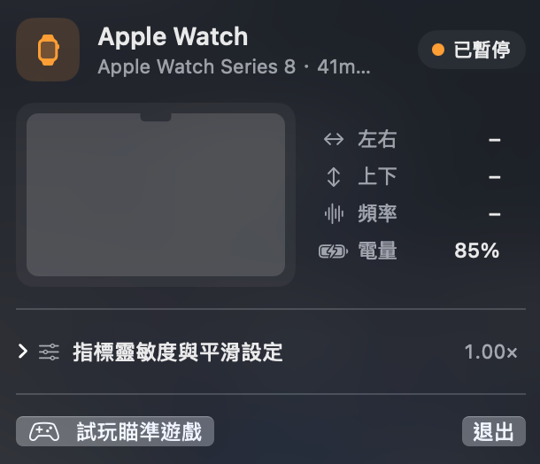

# WatchPointer — Menu Bar Edition（原生選單列版）


用 **Apple Watch** 當作 Mac 的無線隔空雷射滑鼠：錶頭指向螢幕移動游標、輕點左鍵、長按拖曳、轉動數位錶冠捲動頁面。  
純藍牙 BLE 直連，不需要 Wi-Fi 中繼或額外伺服器。

Use your **Apple Watch** as a motion-controlled air pointer for your Mac — point to move the cursor, tap to click, hold to drag, and spin the Digital Crown to scroll. Direct Bluetooth LE connection, no Wi-Fi relay or external server needed.

> **Fork Notice / 改版說明**：本專案基於 [umarz317/WatchPointer](https://github.com/umarz317/WatchPointer)（MIT License）改寫。原版將控制台做成懸掛在螢幕中央的黑色瀏海浮窗；本版本將其重寫為**原生 macOS 右上角選單列（Menu Bar）獨立 App**，特別適合無瀏海的 MacBook Air / 外接螢幕用戶，或任何不希望螢幕中央被遮擋的使用者。

<p align="center">
  
  &nbsp;&nbsp;
  
</p>

---

## 本版亮點 / What's New in Menu Bar Edition

| 項目 / Feature | 原版 (Upstream) | 本版 (Menu Bar Edition) |
| --- | --- | --- |
| **Mac 介面 / UI** | 螢幕上方中央黑色偽瀏海浮窗 | **原生右上角選單列圖示＋彈出面板**（無瀏海、不佔 Dock） |
| **靈敏度調整 / Tuning** | 需關掉終端機重新傳 CLI 參數 | 面板內建 **速度／防抖／響應滑桿**，即時生效並自動記住設定 |
| **安裝與退出 / App Packaging** | 透過終端機 `swift run` 與 `Ctrl+C` | 獨立雙擊 **`WatchPointer.app`**（支援 Releases 直接下載或一鍵打包），右鍵／面板內一鍵退出（`⌘Q`） |
| **權限提示 / Permissions** | 終端機文字提示 | 面板即時偵測「輔助使用」與藍牙狀態，附一鍵跳轉系統設定 |
| **手錶部署排雷 / Watch Setup** | 簡短 4 行說明 | 附完整 **Apple Watch 開發者模式／Xcode 連線排雷指南**（涵蓋 `0xe800000c`、`Code 1001`、Xcode 27 Device Hub） |

---

## 系統需求 / Requirements

- **Mac**：macOS 14 (Sonoma) 或以上，具備藍牙（本版已於 macOS 26 / Apple Silicon 實測通過）
- **Apple Watch**：watchOS 11 或以上（實測於 Apple Watch Series 8 GPS）
- **Xcode**：Xcode 16 或以上（用於將手錶端 App 簽名部署到 Apple Watch；免費個人 Apple ID 即可，不需付費開發者帳號）

---

## 快速安裝 / Quick Start

### 1. Mac 端選單列 App（二選一）

#### 方式 A：直接下載編譯好的 Release（最簡單，免編譯）
1. 前往本頁右側 **[Releases](../../releases)** 下載最新版的 `WatchPointer-MenuBar-macOS-arm64.zip`。
2. 解壓後把 **`WatchPointer.app`** 拖進 **`/Applications`（應用程式）** 資料夾。
3. 因為沒有付費 Apple 公證簽名，第一次打開前先在終端機解除下載隔離屬性（或在「系統設定 → 隱私權與安全性」點「仍要打開」）：
   ```bash
   xattr -cr /Applications/WatchPointer.app
   open /Applications/WatchPointer.app
   ```

#### 方式 B：從原始碼一鍵編譯打包
```bash
git clone https://github.com/Gaderis/WatchPointer.git
cd WatchPointer
./Mac/build-app.sh --install
open /Applications/WatchPointer.app
```
> 若首次打開面板顯示橘色「需要輔助使用權限」提示，點擊面板內的 **「前往設定」**，在 **系統設定 → 隱私權與安全性 → 輔助使用** 開啟 **`WatchPointer`** 並允許 **藍牙** 權限即可。

---

### 2. Apple Watch 端安裝（透過 Xcode）

1. 打開 `Watch/WatchPointer.xcodeproj`。
2. 左側選中藍色專案 **`WatchPointer`** → Target 選 **`WatchPointer`** → **`Signing & Capabilities`**：
   - 在 **Team** 選擇你的個人 Apple ID（若尚未登入，至 `Xcode → Settings → Accounts` 點 `+` 登入免費 Apple ID）。
   - 將 **Bundle Identifier**（預設 `com.example.watchpointer`）改成任意屬於你的唯一名稱（例如 `com.yourname.watchpointer`）。
3. 確認 **iPhone 與 Apple Watch** 皆已開啟「開發者模式」（見下方完整排雷指南）。
4. 在 Xcode 頂部裝置選單選擇你的 **Apple Watch**，按下 **`⌘R`** 編譯並安裝到手錶。
   - 若首次在手錶打開時提示「不受信任的開發者」，到 **iPhone 設定 → 一般 → VPN 與裝置管理** 點信任即可。
   - 免費 Apple ID 簽名有效期限為 **7 天**，到期後打開 Xcode 再按一次 `⌘R` 即可續簽。

---

### 3. 配對與操作 / Pair & Point

1. 打開 Mac 右上角選單列的 **WatchPointer**（確認藍牙廣播中）。
2. 在 Apple Watch 打開 **WatchPointer** → 點你 Mac 名稱旁的 **Pair**。
3. 將手錶 **12 點鐘方向** 對準螢幕正中央，點一下 **Center（準心圖示）** 完成置中校準。
4. **操作方式**：
   - **移動**：像拿雷射筆般轉動手腕／手錶
   - **左鍵 / 拖曳**：輕點螢幕左鍵；按住不放即可拖曳
   - **捲動**：轉動數位錶冠（Digital Crown）
   - **下方三顆按鈕**：右鍵 / 重新置中 / 暫停操控
   - **瞄準小遊戲**：點 Mac 選單列面板底部的 **「試玩瞄準遊戲」**（或開啟 `Game/index.html` 按 `F` 全螢幕）測試手感！

> **拿在手上操作的小技巧 / Tips for Handheld Use**：  
> 在 iPhone 的 **Watch** App 關閉 **密碼 → 手腕偵測**（避免離腕鎖定）；在手錶本機設定 **螢幕顯示與亮度 → 喚醒持續時間 = 70 秒**、**一般 → 返回錶面 → WatchPointer = 1 小時後**。

---

## Apple Watch 開發者模式與 Xcode 部署排雷實戰指南
## Troubleshooting Apple Watch Developer Mode & Xcode Deployment

網路上很多人說開啟 Apple Watch 開發者模式「很看臉」——實際上只要看系統底層日誌，就能發現每一個卡點都有明確原因與可驗證的解法。以下是我們在實測中踩過並逐一解決的 5 個關鍵問題：

Many developers say getting Apple Watch Developer Mode to appear "feels like pure luck." Every failure actually has a concrete cause in macOS's `remotepairingd` / CoreDevice stack. Here are the 5 real hurdles we encountered and solved:

---

### 問題 1：Xcode 27+ 找不到 `Window → Devices and Simulators`？
**原因**：從 **Xcode 27** 開始，Apple 移除了舊的 `Devices and Simulators` 視窗，改整合為全新的 **Device Hub**。  
**解法**：
- 從上方選單列點 **`Xcode → Open Developer Tool → Device Hub`**（或用 Spotlight 搜尋 `Device Hub`）。
- **注意別點錯**：Device Hub 左上角的 **`+`** 是用來建立**虛擬模擬器（Create Simulator）**的（裡面只會列出最新 watchOS 支援的新款模擬機型，不會出現較舊的實體錶款如 Series 8），**實體手錶不需要點 `+` 建立**。
- 另外，Device Hub 點擊 iPhone 的「View Screen」若提示需要 iOS 27+，這只是螢幕鏡像功能限制，**完全不影響**把 WatchPointer 部署到 iOS 26 / watchOS 26 或更早系統上。

---

### 問題 2：Xcode 沒下載 watchOS 平台元件（需要下載 16 GB 的 iOS 嗎？）
**解法**：
- 到 **`Xcode → Settings → Components / Platforms`**，只需下載 **`watchOS` Platform Support**（約 3.9 GB）。
- **不需要**下載 16 GB 以上的 `iOS` Platform Support（因為 `WatchPointer` 是純手錶 App `WKWatchOnly = YES`）。
- 新版 watchOS SDK（例如 `watchOS 27.2`）**向下相容**舊版手錶系統（如 `watchOS 11` / `watchOS 26.1`），不需要另外下載舊版 SDK。

---

### 問題 3：iPhone 開發者模式開了，但 Apple Watch 永遠不顯示「開發者模式」？（`0xe800000c` 根因與必成解法）

**真正的底層原因（為什麼大家覺得「看臉」）**：  
透過 `log show` 檢查 macOS 的 `remotepairingd` 日誌可以看到，Mac 透過 iPhone 的 `companion_proxy` 其實已經抓到了手錶（`proxiedWatches`），但在嘗試向手錶 `lockdownd` 查詢公鑰做首次信任配對時：
```text
Received MobileDevice device attach notification for proxied device <WATCH_UDID>
Failed to start service via AppleUSBDeviceMux: 0xe800000c (kAMDTimeOutError)
Failed to query public key: 0xe800000c
AMDevicePairWithCallback failed with error RemotePairingError(1015, kAMDTimeOutError)
```
只要當時手錶螢幕暗掉、鎖定或 Wi-Fi 處於省電休眠，**20 秒逾時失敗一次後，`remotepairingd` 就會直接放棄且不再自動重試**！之後不管你在手錶裡怎麼翻設定，開發者模式都不會出現。

**可驗證、不再靠運氣的 5 步解法（Deterministic 5-Step Fix）**：
1. **暫停 Mac 上的 VPN / TUN 代理軟體**（避免虛擬網卡干擾本地隧道）。
2. **讓 Apple Watch 保持全速喚醒（最關鍵！）**：
   - 把 Apple Watch **放到原廠磁吸充電座上充電並解鎖**（充電時 watchOS 會強制保持 Wi-Fi 與 `lockdownd` 全速運作不休眠；若沒充電座，請關閉低耗電模式並在配對期間持續保持螢幕亮起）。
   - 若先前已卡住多次，先將 **iPhone 與 Apple Watch 各重開機一次**，清掉卡死的 `companion_proxy`。
3. **在 iPhone 重置信任紀錄**：
   - 打開 iPhone **`設定 → 開發者 → 清除受信任的電腦（Clear Trusted Computers）`**。
4. **重啟 Mac 上卡住的配對守護行程，再重新插線**：
   - 保持 Xcode 開啟，在 Mac 終端機執行：
     ```bash
     sudo killall -9 remotepairingd CoreDeviceService
     ```
   - 將連接 Mac 與 iPhone 的 USB 線**拔掉等 3 秒再插回去**，在 iPhone 點 **「信任這部電腦」** 並輸入密碼。
   - **20 秒內緊盯 Apple Watch 螢幕**：手錶會跳出 **「信任這部電腦？」**，立刻點 **信任** 並輸入密碼。
5. **用指令直接驗證（不用盲猜）**：
   ```bash
   xcrun devicectl list devices
   ```
   只要清單裡出現你的 Apple Watch，代表隧道已打通！立刻打開 Apple Watch 本機 **`設定 → 隱私權與安全性`** 滑到最底部，**「開發者模式」**就會出現（開啟後依提示重開機並確認即可）。

---

### 問題 4：按 `⌘R` 編譯成功，卻跳出 `RemotePairingError Code 1001`？
```text
A connection to this device could not be established. (CoreDeviceError Code: 4000)
Timed out while attempting to establish tunnel using negotiated network parameters. (RemotePairingError Code: 1001)
```
**原因**：簽名與編譯其實都已經成功，只是 Mac 透過區域網隧道把 `.app` 傳到手錶時被擋住。  
**解法**：
1. **完全關閉 Mac 的 VPN（特別是 TUN / 增強模式）**——VPN 虛擬網卡會吃掉 Xcode 與手錶間的點對點 IPv6 隧道封包。
2. 確認 **Mac 與 Apple Watch 連在同一個 Wi-Fi**（在手錶打開 `設定 → Wi-Fi` 確認有藍色勾勾，避免 Mac 連熱點但手錶停在家用 Wi-Fi，或手錶只走藍牙）。
3. 回到 Xcode 再按一次 **`⌘R`**（部署到手錶不需要連外網，裝完後就能重新打開 VPN）。

---

### 問題 5：Xcode 卡在 `Copying OS library symbols from Apple Watch (0%)`？
**原因**：首次透過無線連接除錯器（LLDB）時，Xcode 會從手錶複製數百 MB 系統符號檔，走手錶無線通道非常慢。  
**解法**：
- **狀況 A**：如果 Xcode 左上角停止鈕 `■` 已亮起，且手錶 App 列表裡已經看到 `WatchPointer` 圖示，代表**已經裝好了**——直接點停止鈕 `■` 並退出 Xcode（`⌘Q`）即可獨立使用！
- **狀況 B**：如果還沒裝進去就被卡住，到選單 **`Product → Scheme → Edit Scheme…（⌘<）`** → 左側 **`Run`** → 右側 **`Info`** 分頁 → **取消勾選 `Debug executable`** → 關閉後再按 **`⌘R`**，即可跳過符號複製、數秒內完成安裝。

---

## 安全提醒 / Security Note

配對動作由 Apple Watch 端發起，Mac 端接收程式目前未設額外配對確認視窗。不使用時建議點右上角選單列圖示 → **退出（`⌘Q`）** 關閉接收端。

---

## Contributors & Credits（貢獻者與致謝）

- **Original Author / 原專案作者**：[Umar Afzal (@umarz317)](https://github.com/umarz317) — Created the original [WatchPointer](https://github.com/umarz317/WatchPointer) architecture, 1€ filter cursor engine, BLE protocol, watchOS app, and Sky Shot game.
- **Menu Bar Edition & Troubleshooting Guide / 選單列版與排雷指南**：
  - **[@Gaderis](https://github.com/Gaderis)** — Menu Bar Edition idea, Apple Watch Series 8 / MacBook Air real-device testing, Watch Developer Mode troubleshooting validation, and bilingual release curation.
  - **Antigravity** *(Google DeepMind AI Assistant)* — Native macOS Menu Bar UI & live tuning popover implementation, standalone `.app` packaging script, `remotepairingd` / CoreDevice root-cause diagnostics, and documentation.

---

## License

MIT License — Copyright (c) 2026 Umar Afzal. See [LICENSE](LICENSE).
